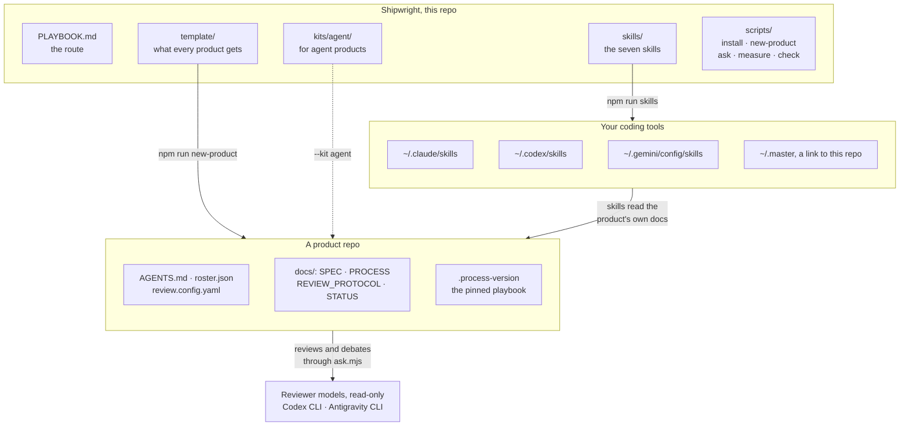
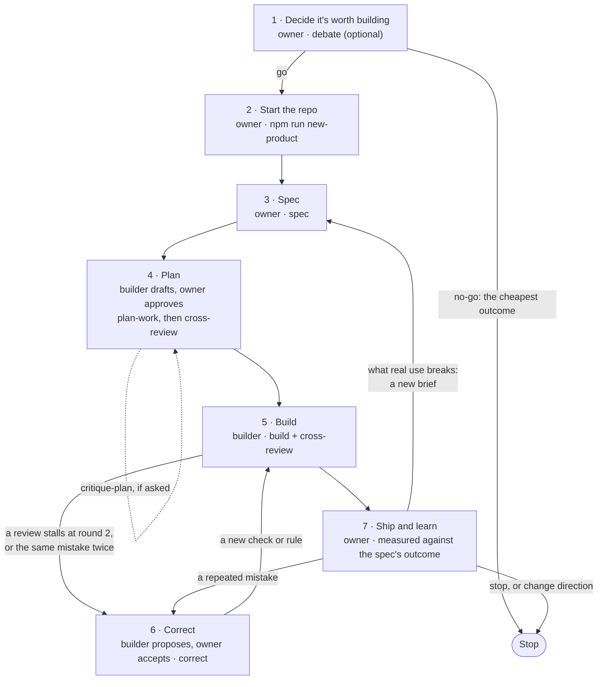
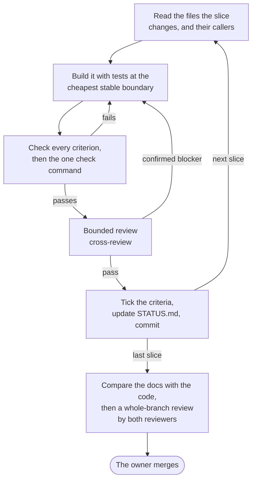
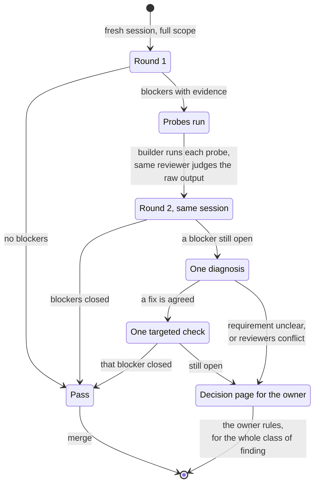
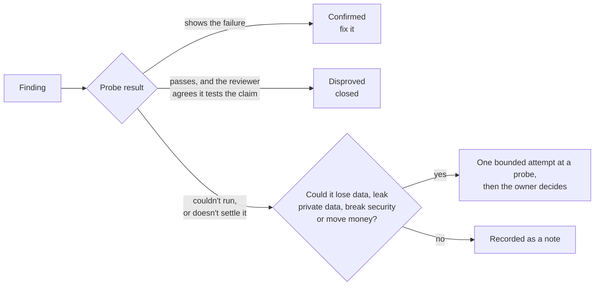
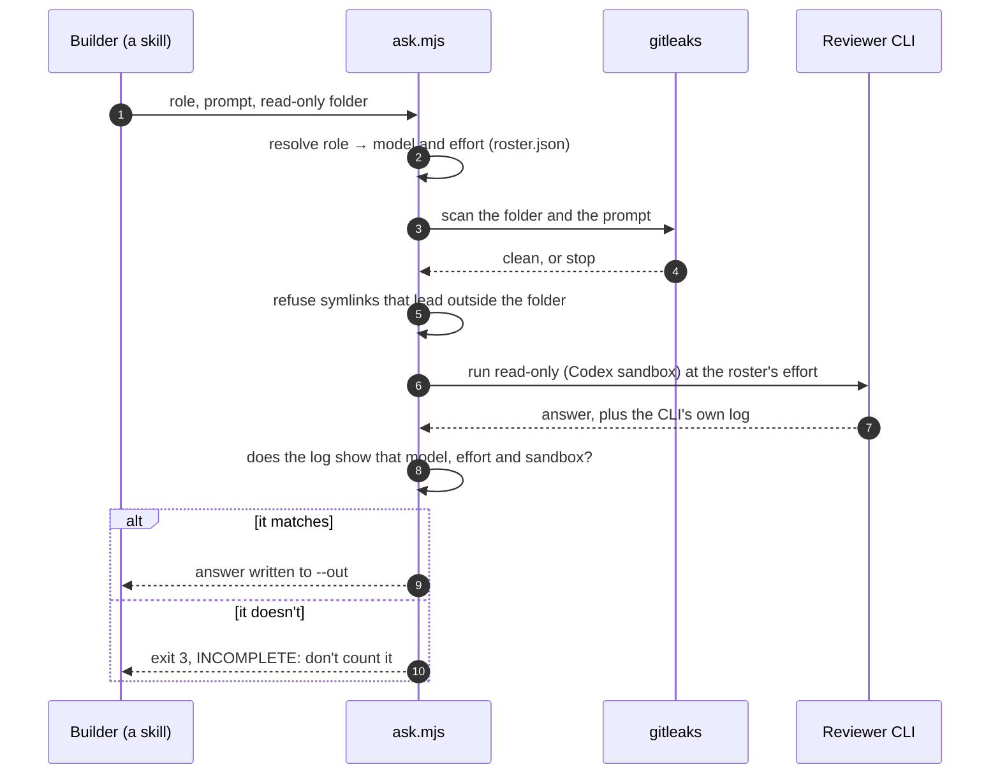

<div align="center">

# Shipwright

**A playbook for building products with coding agents.**

One template that every product starts from, seven skills that run each stage, and reviews by a second model that end in a merge, a fix or a decision for you, never in another open round.

[](https://github.com/hiteshdundi01/shipwright/actions/workflows/check.yml)
[](LICENSE)


[Why](#why) · [How it fits together](#how-it-fits-together) · [Quick start](#quick-start) · [The route](#the-route) · [Reviews](#how-a-review-ends) · [Scripts](#scripts) · [Customize](#make-it-yours) · [Contributing](CONTRIBUTING.md)

</div>

---

## Why

Coding agents write code fast. The time goes into everything around the code: reviews that never settle, rules that collect exceptions, a model swap that quietly changes a result, three tools each with its own copy of the instructions. Shipwright is one person's answer to that, written down so an agent can follow it and checked so it stays that way.

- **You decide what to build. Agents build and review it.** Your spec governs every plan, fix and review. A model can't approve away a line of it.
- **Reviews are bounded.** Two rounds, then one diagnosis, then one targeted check or a one-page decision for you. The same rule applies to plans, documents and the review tooling itself.
- **A blocker needs evidence.** It has to be a current defect, an unmet acceptance criterion or a breach of a hard rule, with a probe or a code path to back it. Everything else is a note.
- **Roles, not models.** The docs name `builder`, `reviewer_a`, `reviewer_b` and `debater`. One file, `roster.json`, says which model fills each role, so a model swap is one edit.
- **One source for every tool.** The same skills are linked into Claude Code, Codex and Antigravity. Each product pins the playbook version it started from.
- **Mistakes become checks.** When the same kind of mistake happens twice, the `correct` skill adds the cheapest prevention that will hold, and proves it fails on the real past mistake.

## How it fits together



Skills hold no policy of their own. They read the product's `docs/`, which came from `template/`, so each rule lives in one place.

## Quick start

You need **Node 22+**, **git** and **[gitleaks](https://github.com/gitleaks/gitleaks)** (`brew install gitleaks`). The reviewer and debater roles need the **[Codex CLI](https://github.com/openai/codex)**, and the **Antigravity CLI** for Gemini models. The builder role runs in **[Claude Code](https://claude.com/claude-code)**.

**1. Clone and check it**

```bash
git clone https://github.com/hiteshdundi01/shipwright.git ~/shipwright
```

```bash
cd ~/shipwright && npm run check
```

No dependencies to install. `check` runs the repo's own rules and the scripts' tests.

**2. Pick your models**

Edit [`template/roster.json`](template/roster.json) so each role names a model your CLIs can run (see [Make it yours](#make-it-yours)).

**3. Link the skills into your tools**

```bash
npm run skills
```

This is a dry run: it prints what it would link and changes nothing. Then apply it:

```bash
npm run skills -- --apply
```

Anything it replaces is moved first to `~/.master-backup/<stamp>/`, and `-- --restore <stamp>` puts it back. To try one skill first, add `-- --only cross-review`.

**4. Start a product**

```bash
npm run new-product -- ~/projects/acme --name "Acme"
```

Add `--kit agent` for a product where a model decides or acts, or `--base <repo>` to lay the playbook over an existing repo's code.

**5. Work in it**

Open the product in your coding agent and talk to it in plain words. The skills trigger on what you ask:

| You say | Skill | You get |
| --- | --- | --- |
| "Grill me on this idea, then write the spec" | `spec` | `docs/SPEC.md`, in your words, with checkable needs |
| "Plan the work in docs/SPEC.md" | `plan-work` | `docs/PLAN.md`, with slices, slice 1 in the real environment |
| "Implement the plan" | `build` | Merged slices, each one verified and reviewed |
| "Review this branch" | `cross-review` | A bounded review by a second model |
| "Stop this mistake happening again" | `correct` | A check that fails on the real past mistake |
| "Debate this: is it worth building?" | `debate` | Two rounds against another model, and what's left for you to decide |
| "Critique the plan" | `critique-plan` | A CUT / CHANGE / ADD worklist (only when asked) |

## The route

Every product follows the same seven stages. Start at the stage the work needs: a small fix starts at Build.



[`PLAYBOOK.md`](PLAYBOOK.md) has each stage in full: who decides, what it leaves behind, and the eight questions a go/no-go case must answer.

### Inside Build: one slice at a time



## How a review ends

The full contract is [`template/docs/REVIEW_PROTOCOL.md`](template/docs/REVIEW_PROTOCOL.md). A routine change gets one reviewer. A high-stakes change (sign-in, personal data, deletion, money, secrets, migrations, release gates) and every whole branch get two, working independently.



Each finding ends in one of three states. Nothing is dropped silently.



## Asking a reviewer safely

Every review and debate goes through one script, [`scripts/ask.mjs`](scripts/ask.mjs). It refuses to send anything that looks like a secret, and it checks the CLI's own log afterwards, so an answer from the wrong model never counts.



## What's in the repo

| Path | What it is |
| --- | --- |
| [`PLAYBOOK.md`](PLAYBOOK.md) | The route from idea to shipped product: who decides at each stage, what it leaves, which skill runs it |
| [`template/`](template/) | What every product gets: `AGENTS.md`, `roster.json`, `review.config.yaml`, and `docs/` with the spec, process, review protocol, code standards, status and templates |
| [`kits/agent/`](kits/agent/README.md) | For products where a model decides or acts: agent standards, a proven stack, checks to adopt in slice 1, ten add-on briefs, and a worked spec and plan |
| [`skills/`](skills/) | The seven skills, each a `SKILL.md` that any of the three tools can load |
| [`scripts/`](scripts/) | `install`, `new-product`, `ask`, `measure` and `check`, with their tests. Node built-ins only |
| [`docs/debates/`](docs/debates/README.md) | Where each policy decision about this repo is recorded |
| [`AGENTS.md`](AGENTS.md) | The rules for an agent working on this repo itself |

## Scripts

Each script prints its full usage with `--help`.

| Command | What it does |
| --- | --- |
| `npm run check` | Runs this repo's rules (skills name roles, not models; links resolve; always-read files stay short; no secrets) and the scripts' tests |
| `npm run skills` | Links each skill into `~/.claude/skills`, `~/.codex/skills` and `~/.gemini/config/skills`, and `~/.master` to this repo. Dry run unless you pass `--apply`. `--copy` for a tool that doesn't follow symlinks, `--restore <stamp>` to undo a run |
| `npm run new-product -- <folder> --name "<Name>"` | Starts a product with the playbook pinned in `.process-version`. It refuses while `template/` or `kits/` has uncommitted changes, so the pin names exactly the files the product got |
| `npm run ask -- <role> --dir <folder> --prompt <file> --out <file>` | Asks a reviewer or debater, read-only, after a secret scan, and checks the CLI's log for the right model and effort |
| `npm run measure -- <product>` | Prints a product's milestones, your message count and its commit mix, from local records only. It sends nothing anywhere |

## Make it yours

- **Models.** [`template/roster.json`](template/roster.json) maps roles to models. Each model has a `cli` (`codex` or `agy` for reviewers), an `id` the CLI accepts, and an `effort`. Change them to models you can run, then do one review run to see that `ask.mjs` verifies the model and effort from the CLI's log. A product keeps its own copy, so changing the template doesn't touch products you've already started.
- **What counts as high-stakes.** Each product's `review.config.yaml` lists the paths that get two reviewers, and the paths a reviewer must never see (`.env`, keys, real personal data, sealed evaluation answers).
- **Your standards.** `template/docs/CODE_STANDARDS.md` holds the hard rules a reviewer can block on, the advisory ones, and a Lessons table the `correct` skill keeps.
- **The playbook itself.** Fork it. Changing the review contract or the roles is policy: debate it first with the `debate` skill, and record the outcome in `docs/debates/`.

A note on names: inside its own docs the repo calls itself **master**, as in the master copy every product is copied from. That's why the installer links it at `~/.master`, and why a product's docs point to `~/.master/...`.

## FAQ

<details>
<summary><b>Do I need all three coding tools?</b></summary>

No. The builder runs in Claude Code. Reviewers need at least one CLI that `ask.mjs` drives: Codex, or Antigravity for Gemini models. Point every reviewer role at the models you have. The installer links the skills into all three tools' folders, and a tool you don't use just never reads its copy.
</details>

<details>
<summary><b>Will it send my code anywhere?</b></summary>

Only to the reviewer CLI you configure, and only after gitleaks finds nothing secret-looking in what would be sent. The paths in a product's `exclude_paths` are never sent in any form. `measure` and `check` run locally and send nothing.
</details>

<details>
<summary><b>Can I adopt it for an existing repo?</b></summary>

Yes: `npm run new-product -- <new folder> --name "<Name>" --base <existing repo>`. It copies the repo's tracked files (never its `.env`, history or ignored files), keeps its stack, standards and brand, and moves its old spec, status and plans to `docs/base/` to read.
</details>

<details>
<summary><b>How do I upgrade a product to a newer playbook?</b></summary>

On purpose, never automatically. `.process-version` names the commit the product started from. An upgrade is a brief like any other: compare the product's adapted docs with the new template, and carry over what still fits.
</details>

## Credits

Some skills and template docs adapt ideas from **pstack** by Lauren Tan and **Skills For Real Engineers** by Matt Pocock (both MIT), and from Google's **Elephant-Goldfish Model** and Google Research's **Harness²** (both Apache-2.0). [`CREDITS.md`](CREDITS.md) says what came from where, and keeps the license notices.

## License

[MIT](LICENSE) © 2026 Hitesh Dundi
